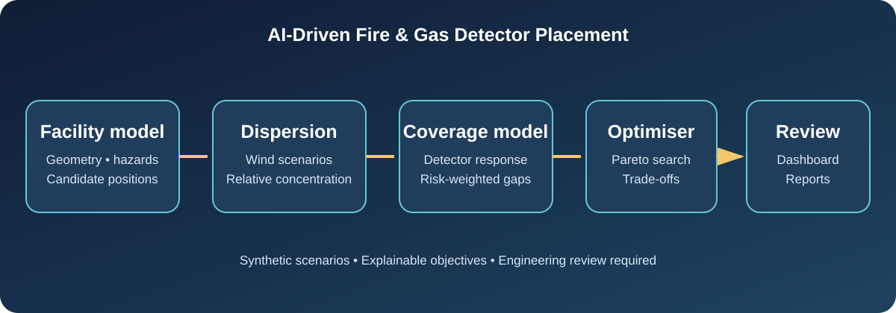
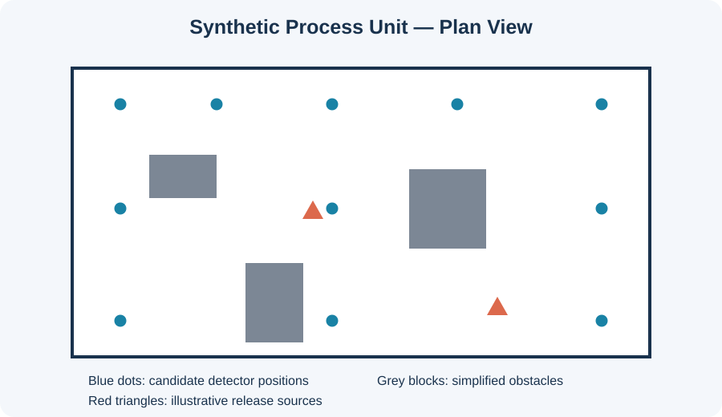
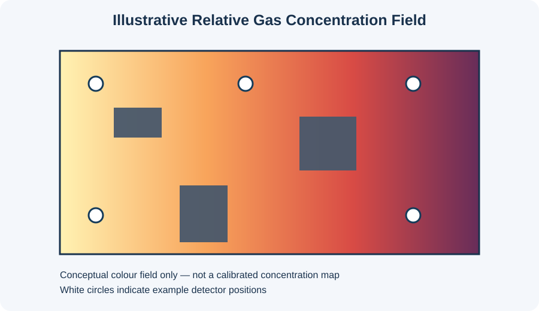
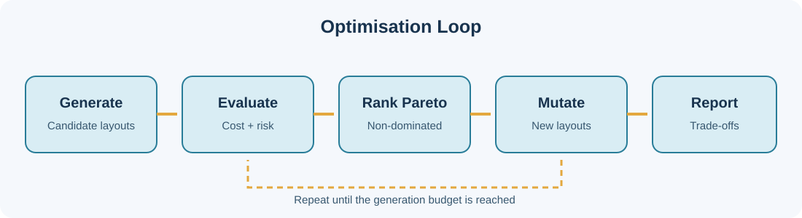

# AI-Driven Fire & Gas Detector Placement Optimisation



An explainable research prototype for exploring where fixed gas detectors could be positioned in a simplified industrial facility. It combines synthetic facility geometry, Gaussian-plume-inspired gas concentration fields, detector response modelling, and a multi-objective evolutionary search.

> **Important safety boundary:** This is an educational engineering prototype, not a certified gas-detection design tool. It does not replace CFD, IEC/ISA compliance work, a competent fire-and-gas engineer, vendor detector data, or site-specific validation. All included facilities and scenarios are synthetic.

## What it does

- Loads a small 2D facility from JSON (dimensions, obstacles, hazard sources and candidate detector points).
- Simulates multiple steady-state gas-release scenarios using a Gaussian plume approximation.
- Estimates detector response using distance attenuation and line-of-sight obstruction checks.
- Scores layouts on **risk-weighted coverage**, **detector count/cost**, and **worst-case uncovered risk**.
- Searches for a set of non-dominated layouts using a compact NSGA-II-style evolutionary optimiser.
- Exposes a Streamlit dashboard and a reproducible command-line workflow.

## Visual tour

| Synthetic facility | Example coverage field |
|---|---|
|  |  |



## Quick start

Python 3.10+ is recommended.

```bash
python -m venv .venv
# Windows: .venv\\Scripts\\activate
source .venv/bin/activate
pip install -r requirements.txt
pip install -e .
python -m firegas.cli --facility data/facilities/process_unit.json --output outputs
```

Open the interactive dashboard:

```bash
streamlit run dashboard/app.py
```

## Project structure

```text
src/firegas/
  facility.py       JSON loading and domain models
  dispersion.py     scenario concentration fields
  coverage.py       detector response and layout scoring
  optimisation.py   evolutionary multi-objective search
  reporting.py      CSV/JSON outputs and plot generation
  cli.py            command-line entry point
data/facilities/    synthetic example facility
tests/              unit and integration tests
dashboard/          Streamlit interface
docs/images/        repository diagrams (SVG)
```

## Reproducible CLI outputs

The CLI writes:
- `pareto_front.csv` — non-dominated detector layouts and objective values
- `best_layout.json` — selected compromise layout and detector coordinates
- `coverage.png` — scenario coverage visualisation
- `concentration.png` — simulated concentration field for the first scenario
- `summary.json` — run settings and objective definitions

The default compromise is selected by normalising objectives and minimising their Euclidean distance to the ideal point. Review the Pareto CSV rather than treating that compromise as universally optimal.

## Model assumptions

### Gas dispersion
For each release source, the prototype uses a reflected Gaussian plume approximation on a horizontal plane. Concentration is a relative model output, not a calibrated ppm value. Wind direction and speed, source strength, and dispersion spread are configurable. Multiple sources are superposed.

### Detector response
Each candidate detector receives a response score from the maximum normalised concentration at its location across scenarios, attenuated by distance to the source and reduced where a facility obstacle blocks the source-to-detector segment. A grid cell is considered covered when its response exceeds the configured threshold.

### Optimisation
The optimiser searches subsets of candidate detector positions. It minimises:
1. installation cost (detector count multiplied by unit cost),
2. uncovered risk (risk-weighted fraction of hazard grid cells below the coverage threshold),
3. worst-scenario uncovered risk.

The returned Pareto front makes trade-offs explicit. It is a prototype evolutionary search, not a proof of global optimality.

## Example result

Run the CLI to generate plots and metrics from the bundled synthetic example. Results depend on the random seed and configuration. The repository deliberately does not claim that a particular detector count or layout is safe for a real facility.

## Tests

```bash
pytest
```

## Next engineering steps

- Replace the simplified plume with validated CFD or a recognised dispersion model.
- Import and preserve real 3D CAD/BIM geometry and elevations.
- Incorporate detector-specific performance curves, response times, gas properties, ventilation and weather distributions.
- Validate against site measurements and domain-expert review.
- Add traceable design constraints, standards mapping and formal verification before any operational use.

## Licence

MIT — see [LICENSE](LICENSE).
